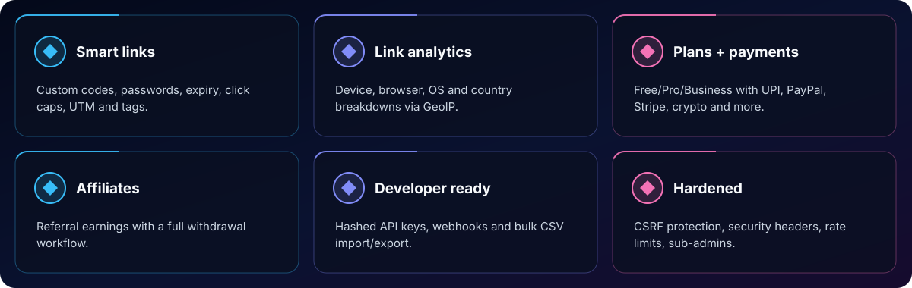
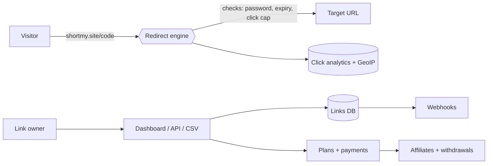

  
  
  
  

  <a href="#-overview"><b>Overview</b></a> &nbsp;•&nbsp;
  <a href="#-features"><b>Features</b></a> &nbsp;•&nbsp;
  <a href="#-tech-stack"><b>Tech</b></a> &nbsp;•&nbsp;
  <a href="#%EF%B8%8F-architecture"><b>Architecture</b></a> &nbsp;•&nbsp;
  <a href="#-source-code"><b>Source</b></a>

## ✨ Overview

**ShortMy** ([shortmy.site](https://shortmy.site)) is a self-hosted PHP URL-shortener SaaS. Links support custom codes, passwords, expiry, click caps, UTM parameters and tags, with guest and signed-in shortening behind rate limits.

It ships with per-link analytics (device, browser, OS and country via GeoIP), Free/Pro/Business plans with many payment methods, an affiliate system with withdrawals, sub-admin permissions, six UI themes with light/dark modes, webhooks, bulk CSV import/export, SMTP, hardened security headers, CSRF protection and hashed API keys.

  
   🖥️ Live at <a href="https://shortmy.site"><b>shortmy.site</b></a>

## 🚀 Features

  

| Feature | What it does |
|:--|:--|
| **Smart links** | Custom codes, passwords, expiry, click caps, UTM and tags. |
| **Link analytics** | Device, browser, OS and country breakdowns via GeoIP. |
| **Plans + payments** | Free/Pro/Business with UPI, PayPal, Stripe, crypto and more. |
| **Affiliates** | Referral earnings with a full withdrawal workflow. |
| **Developer ready** | Hashed API keys, webhooks and bulk CSV import/export. |
| **Hardened** | CSRF protection, security headers, rate limits, sub-admins. |

## 🧰 Tech Stack

## 🏗️ Architecture

## 🔒 Source Code

> [!NOTE]
> This is a **showcase repository**. The production source code of **ShortMy** is private and is not published here.
> Want a walkthrough, a similar build for your business, or licensing? **[Get in touch →](https://ajendra.info/contact)**

## 👤 Author

**Ajendra** — Full Stack Developer · Security Researcher · AI Engineer · Startup Advisor

⭐ If you like this project, star the repo — and check out my other work on <a href="https://ajendra.info/projects">ajendra.info/projects</a>.

